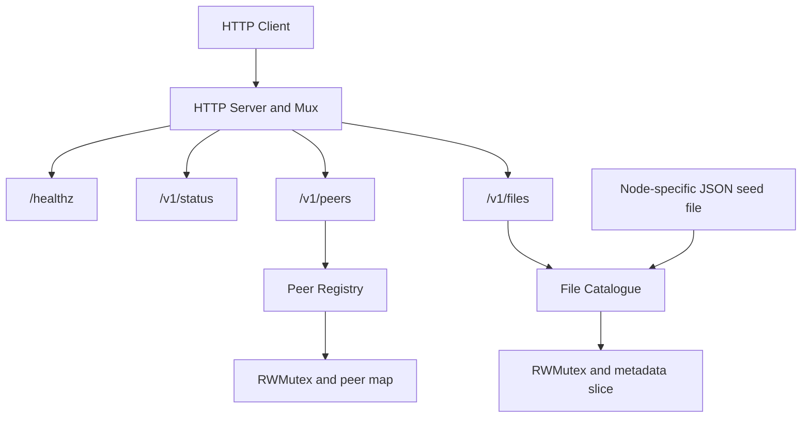

# Week 3 Architecture

## Overview

The application uses an HTTP server to provide health, status, peer, and file-metadata resources. The peer registry stores information about other nodes. The file catalogue stores metadata about files, not their contents.

## Architecture diagram

## Peer registry

The registry stores peers in a map using the peer ID as the key. A mutex protects concurrent access. Adding a peer checks for an existing ID while holding the write lock, so concurrent requests cannot add the same ID more than once. Snapshots are copied and sorted by peer ID.

## File catalogue

The catalogue stores file metadata in a slice. Replacement validates the complete candidate list before changing the stored catalogue. Invalid metadata or duplicate filenames cause the replacement to fail without replacing the existing data. Snapshots are independent copies sorted by filename.

## HTTP behaviour

- `GET /v1/peers` returns the peer registry snapshot.
- `POST /v1/peers` validates and adds a peer.
- A successful peer creation returns HTTP 201.
- A duplicate peer ID returns HTTP 409.
- Invalid peer input returns HTTP 400.
- `GET /v1/files` returns the file catalogue snapshot.
- `GET /healthz` and `/v1/status` remain available from earlier checkpoints.

## Seed data

The `-seed` option loads a JSON file containing file metadata when the node starts. Node A and Node B use different fixtures, so their file catalogues can be compared independently.

## Concurrency and limitations

The registry and catalogue use locks to protect shared state. Tests, including the Go race detector, check the exercised concurrent operations. They cannot prove that every possible execution schedule is free from race conditions. The current catalogue contains metadata only; it does not transfer file contents between nodes.
