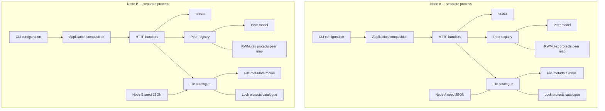

# Week 3 Architecture

## Overview

Week 3 extends the basic node with a peer registry and a file-metadata catalogue. The registry records known peers, while the catalogue stores descriptions of files available to the node. The application keeps domain state separate from HTTP handlers so that state operations do not depend on HTTP response writers or URL paths.

## Architecture Diagram

Each node owns its own in-memory registry and catalogue. The nodes may use the same model definitions, but they do not share the same state collections. Registering a peer records local information; it does not automatically copy state between nodes or prove that the remote peer is online.

## Peer Registry

The peer registry stores peer details in memory, including the peer ID, HTTP address, gRPC address and recorded status. Peer details are validated before registration. Supported status values are `unknown`, `online` and `offline`; these are recorded values, not automatic connectivity measurements.

A read-write mutex protects the peer map. Adding a peer checks for a duplicate ID and inserts the new record while holding the same write lock. This prevents concurrent requests from both successfully registering the same ID. A duplicate registration returns HTTP `409 Conflict`.

The registry returns a new snapshot sorted by peer ID. Callers can inspect the returned slice without directly accessing the registry's internal map. This separates ownership of the live state from the data returned to a caller.

## File-Metadata Catalogue

The catalogue stores file metadata rather than file contents. The metadata includes a filename, size, SHA-256 value and modification timestamp. Validation checks the candidate records, including filename rules, nonnegative numeric values and the hash format. Duplicate filenames are rejected.

The catalogue validates the complete candidate collection before replacing the existing collection. A rejected replacement should leave the previous catalogue unchanged. Its snapshot returns an independent slice sorted by filename, providing predictable results without exposing the catalogue's internal storage.

The `-seed` option loads supplied synthetic metadata for testing. It does not mean that the node scans a live filesystem or transfers the listed files. A valid hash string alone does not prove that file contents have been received or verified.

## HTTP Interface and State Boundaries

The HTTP handlers provide access to the existing status endpoint, peer registry and file catalogue. The peer API uses the registry's operations rather than modifying its internal map directly. A new peer registration returns `201 Created`, a duplicate returns `409 Conflict`, and invalid peer data returns `400 Bad Request`.

The files endpoint obtains catalogue data through a snapshot. This keeps storage ownership inside the catalogue and gives the handler a predictable collection to return. The API exposes metadata, not the underlying file bytes.

## Limitations

The registry and catalogue are in-memory components, so their state is not persistent across process restarts. Peer registration is manual, and this checkpoint does not implement automatic peer discovery, heartbeats or gossip. Recorded statuses do not prove current connectivity.

The catalogue does not provide file-content transfer. Filename validation is also not a complete security policy for a future filesystem-backed store; additional path and file-handling controls would be required. Concurrency tests and race-detector results provide evidence about the executions tested, but they do not mathematically prove that every possible execution is free from data races.
